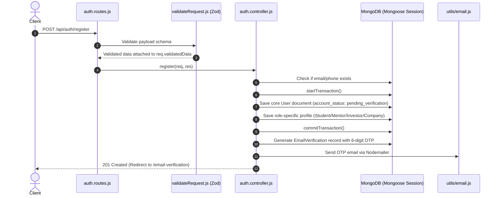
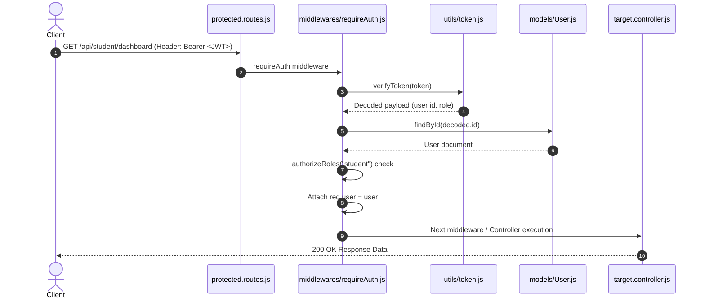

# System Architecture

## Overview

The **Business Orbit Campus Clubs (BOCC)** Backend is a high-performance, role-aware REST API and real-time messaging server. Built on Node.js (Express 5) and MongoDB (Mongoose 9), it provides a multi-tenant platform for university campus chapters, student entrepreneurs, startup incubators, industry mentors, corporate recruiters, and venture investors.

The architecture emphasizes strict separation of concerns through a layered **Model-View-Controller (MVC)** design, transactional multi-document operations, role-based authorization, and real-time state synchronization via WebSockets.

---

## Architectural Principles & Patterns

```
                                  +-----------------------+
                                  |   Client Applications |
                                  | (React Frontend / UI) |
                                  +-----------+-----------+
                                              |
                        HTTP REST API         |         WebSocket (Socket.IO)
                     (Bearer JWT Auth)        |       (Handshake JWT Auth)
                                              v
+-----------------------------------------------------------------------------------+
| Express 5 Application Server (server.js)                                          |
|                                                                                   |
|  +-----------------------------------------------------------------------------+  |
|  | Middleware Pipeline                                                         |  |
|  | - CORS Configuration (cors.js)                                              |  |
|  | - JSON Parser (express.json)                                                |  |
|  | - JWT Authentication & RBAC (requireAuth.js)                                |  |
|  | - Input Validation Engine (validateRequest.js / Zod)                        |  |
|  +-----------------------------------------------------------------------------+  |
|                                                                                   |
|  +---------------------------------------+   +---------------------------------+  |
|  | REST Controllers                      |   | Socket.IO Gateway               |  |
|  | (auth, startup, admin, mentor, etc.)  |   | (utils/socket.js)               |  |
|  +-------------------+-------------------+   +----------------+----------------+  |
|                      |                                        |                   |
|                      v                                        v                   |
|  +---------------------------------------+   +---------------------------------+  |
|  | Domain & Orchestration Services       |   | Real-time Message Dispatch      |  |
|  | - Cascade Service (cascadeService.js) |   | - Chat Rooms (joinChat)         |  |
|  | - Chat Room Service                   |   | - Live Messaging (sendMessage)  |  |
|  | - Journey Engine (startupJourney.js)  |   | - Read Receipts                 |  |
|  +-------------------+-------------------+   +---------------------------------+  |
|                      |                                                            |
|                      v                                                            |
|  +-----------------------------------------------------------------------------+  |
|  | Mongoose ODM Layer (41 Data Models)                                         |  |
|  +-----------------------------------------------------------------------------+  |
+--------------------------------------|--------------------------------------------+
                                       |
                                       v
                         +---------------------------+
                         | MongoDB Database (db.js)  |
                         | (ACID Multi-doc Sessions) |
                         +---------------------------+
```

### Key Design Patterns

1. **Layered MVC Architecture**:
   - **Routes Layer**: Maps HTTP endpoints to validation schemas and controller actions. Enforces role-based guards.
   - **Controllers Layer**: Orchestrates business logic, parses validated inputs, handles transactional boundaries, and formats HTTP responses.
   - **Models Layer**: Encapsulates schema definitions, validation rules, virtual fields, and index definitions using Mongoose.
   - **Services Layer**: Handles complex multi-model operations, cascading entity deletions, and chat room management.

2. **Polymorphic / Dynamic Profile Routing**:
   - User profiles (`StudentProfile`, `MentorProfile`, `InvestorProfile`, `IncubatorProfile`, `CompanyProfile`) extend the core `User` model through 1:1 relationships.
   - Router generator function `createProfileRouter(role)` creates dedicated profile REST endpoints while reusing controller logic.

3. **Multi-Document ACID Transactions**:
   - Critical operations (such as user registration with role profile creation, application submissions, and mentor assignment) use Mongoose sessions (`startTransaction` / `commitTransaction` / `abortTransaction`) to ensure data consistency.

4. **Explicit Cascading Relational Engine**:
   - To overcome MongoDB's absence of native foreign key constraints, `services/cascadeService.js` defines explicit dependency graphs to execute deep cascading deletes across 25+ collections whenever a `User` or `Startup` is deleted.

5. **State-Machine Driven Startup Journey**:
   - Startup progression through stages (*Ideation*, *Validation*, *Prototype*, *MVP*, *Launch*, *Scaling*) is governed by state-machine helper `utils/startupJourney.js`, coupled with reviewer evaluations (`reviewProcessing.js`).

---

## Component Overview & Relationships

```mermaid
graph TD
    Client[Client App / React UI] -->|HTTP REST| Server[server.js / Express 5]
    Client -->|Socket.IO WS| SocketUtil[utils/socket.js]

    subgraph Authentication & Security
        Server --> CORS[config/cors.js]
        Server --> AuthMW[middlewares/requireAuth.js]
        AuthMW --> TokenUtil[utils/token.js]
        AuthMW --> UserModel[models/User.js]
    end

    subgraph API Route Layer
        Server --> AuthRoutes[routes/auth.routes.js]
        Server --> StudentRoutes[routes/student.routes.js]
        Server --> StartupRoutes[routes/startup.routes.js]
        Server --> MentorRoutes[routes/mentor.routes.js]
        Server --> AdminRoutes[routes/admin.routes.js]
        Server --> CompanyRoutes[routes/company.routes.js]
        Server --> InvestorRoutes[routes/investor.routes.js]
        Server --> ChatRoutes[routes/chat.routes.js]
    end

    subgraph Controller Layer
        AuthRoutes --> AuthCtrl[controllers/auth.controller.js]
        StartupRoutes --> StartupCtrl[controllers/startup.controller.js]
        MentorRoutes --> MentorCtrl[controllers/mentor.controller.js]
        AdminRoutes --> AdminCtrl[controllers/admin.controller.js]
        ChatRoutes --> ChatCtrl[controllers/chat.controller.js]
    end

    subgraph Domain Services & Utilities
        AuthCtrl --> PasswordUtil[utils/password.js Argon2]
        AuthCtrl --> EmailUtil[utils/email.js Nodemailer]
        AdminCtrl --> CascadeService[services/cascadeService.js]
        StartupCtrl --> JourneyUtil[utils/startupJourney.js]
        ChatCtrl --> ChatService[services/chatRoomService.js]
    end

    subgraph Data Models Mongoose
        UserModel --> StudentProf[models/StudentProfile.js]
        UserModel --> MentorProf[models/MentorProfile.js]
        UserModel --> InvestorProf[models/InvestorProfile.js]
        UserModel --> CompanyProf[models/CompanyProfile.js]
        StartupModel[models/Startup.js] --> StageModel[models/StartupStage.js]
        StartupModel --> Submissions[models/StageSubmission.js]
        StartupModel --> Reviews[models/Review.js]
    end

    Controller Layer --> Data Models Mongoose
    Data Models Mongoose --> MongoDB[(MongoDB Database)]
```

---

## Data Flow Architecture

### 1. User Registration & Transactional Profile Provisioning



### 2. Dual-Token Authentication & Request Verification



### 3. Cascading Entity Deletion Flow

When an administrator or user triggers deletion of a primary entity (`User` or `Startup`), the centralized `cascadeService` runs an explicit traversal to guarantee data cleanup across 25+ dependent models:

```
[Trigger Delete User]
       |
       +---> Delete Profiles (StudentProfile, MentorProfile, InvestorProfile, etc.)
       +---> Delete Auth Metadata (EmailVerification, PasswordReset, ActivityLog, Notification)
       +---> Delete Mentorship (MentorRequest, MentorAssignment, MentorMeeting)
       +---> Delete Chapter Change Requests
       +---> Delete Chat Rooms & Messages (ChatRoom, Message, InvestorChatRoom, InvestorMessage)
       +---> Delete Reviewer Assignments (Meeting, Review)
       +---> Delete Investor Actions (InvestorWatchlist, InvestorNote, PitchView)
       +---> Delete Job Postings & Applications (Opportunity, Application, ApplicantStatus, RecruiterNote)
       +---> [If Student Founder] ---> Trigger deleteStartupDependencies(startupId)
                                                |
                                                +---> StartupStage & StageSubmission
                                                +---> Meeting & Review
                                                +---> MentorRequest & MentorAssignment
                                                +---> ChatRoom & Messages
                                                +---> InvestorWatchlist, Pitch & PitchView
```

---

## Real-Time Architecture (Socket.IO)

The platform incorporates WebSockets alongside REST APIs to enable real-time messaging between students, mentors, founders, and investors.

```
+------------------+         Handshake with JWT Auth          +-------------------+
|                  | ---------------------------------------> |                   |
| WebSocket Client |                                          | Socket.IO Server  |
|  (Frontend App)  | <--------------------------------------- | (utils/socket.js) |
|                  |             Socket Connected             |                   |
+------------------+                                          +-------------------+
         |                                                              |
         | event: "joinChat" { chatId }                                 |
         |------------------------------------------------------------->| Joins room socket.join(chatId)
         |                                                              |
         | event: "sendMessage" { chatId, message, attachment }        |
         |------------------------------------------------------------->| Broadcasts to room:
         |                                                              | socket.to(chatId).emit("receiveMessage")
         | event: "markMessagesRead" { chatId }                         |
         |------------------------------------------------------------->| Broadcasts read status:
                                                                        | socket.to(chatId).emit("messagesRead")
```

- **Authentication Guard**: Custom Socket.IO middleware verifies the JWT token present in `socket.handshake.auth.token` before connection is accepted.
- **Room Isolation**: Communication is compartmentalized into discrete room IDs based on `ChatRoom` or `InvestorChatRoom` document IDs.
- **State Decoupling**: Message persistence is executed via REST API endpoints (`POST /api/chat/messages`), while real-time delivery occurs asynchronously over WebSockets.

---

## Security & Verification Strategy

1. **Password Hashing**: Uses **Argon2** (`argon2.hash` / `argon2.verify`) with standard salt parameters, avoiding vulnerable legacy algorithms.
2. **JWT Security**: Access tokens (short-lived, signed with `JWT_SECRET`) and Refresh tokens (long-lived, signed with `JWT_REFRESH_SECRET`).
3. **Role-Based Access Control (RBAC)**:
   - 7 distinct roles: `student`, `mentor`, `company`, `investor`, `incubator`, `admin`, `superadmin`.
   - Enforced by `requireAuth`, `authorizeRoles(...)`, and `adminAuth` middleware layers.
4. **Account Lifecycle Gating**:
   - Accounts move through explicit state transitions: `pending_verification` -> `pending_approval` -> `active` (or `rejected` / `suspended`). Protected routes enforce `requireActiveAccount`.
5. **Input Validation**: All incoming requests are parsed against strict **Zod** schemas in `middlewares/validateRequest.js`.
